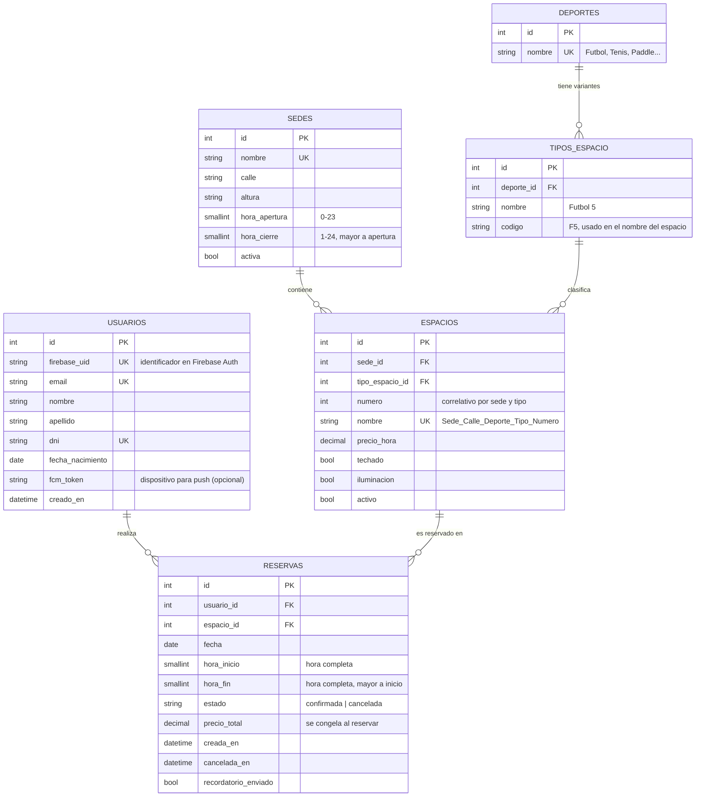

# Modelo de datos

Base de datos relacional (PostgreSQL). Las contraseñas **no** se almacenan: las administra Firebase Authentication.

## Relaciones

| Relación | Cardinalidad | Detalle |
|---|---|---|
| Sede – Espacio | 1 a N | Todo espacio pertenece a una sede. |
| Deporte – Tipo de espacio | 1 a N | Fútbol → Fútbol 5 / 7 / 8 / 11. El tipo depende del deporte. |
| Tipo de espacio – Espacio | 1 a N | Cada espacio tiene un tipo (y por él, un deporte). |
| Usuario – Reserva | 1 a N | Un usuario puede tener muchas reservas. |
| Espacio – Reserva | 1 a N | Un espacio se reserva muchas veces, nunca en horarios superpuestos. |

## Restricciones e integridad

- `usuarios`: `firebase_uid`, `email` y `dni` únicos.
- `sedes`: `0 <= hora_apertura < hora_cierre <= 24`.
- `espacios`: único por (`sede_id`, `tipo_espacio_id`, `numero`) y `nombre` único. El nombre se genera automáticamente, p. ej. `Moron_Rivadavia_Futbol_F5_1`.
- `reservas`: `0 <= hora_inicio < hora_fin <= 24` (duración mínima de 1 hora y horas completas por construcción). La no superposición entre reservas `confirmada` del mismo espacio y fecha se valida en el backend dentro de una transacción con bloqueo del espacio.
- Cancelar una reserva cambia `estado` a `cancelada` (no se borra), de modo que queda en el historial y el horario se libera.
